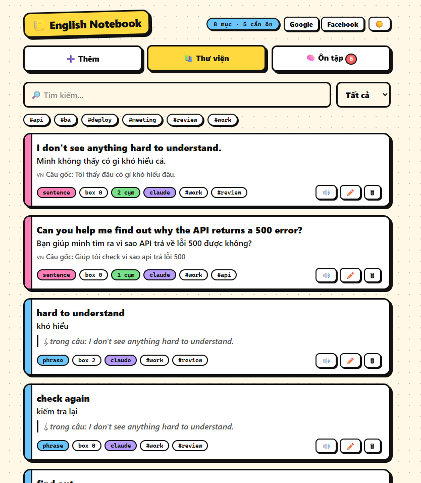
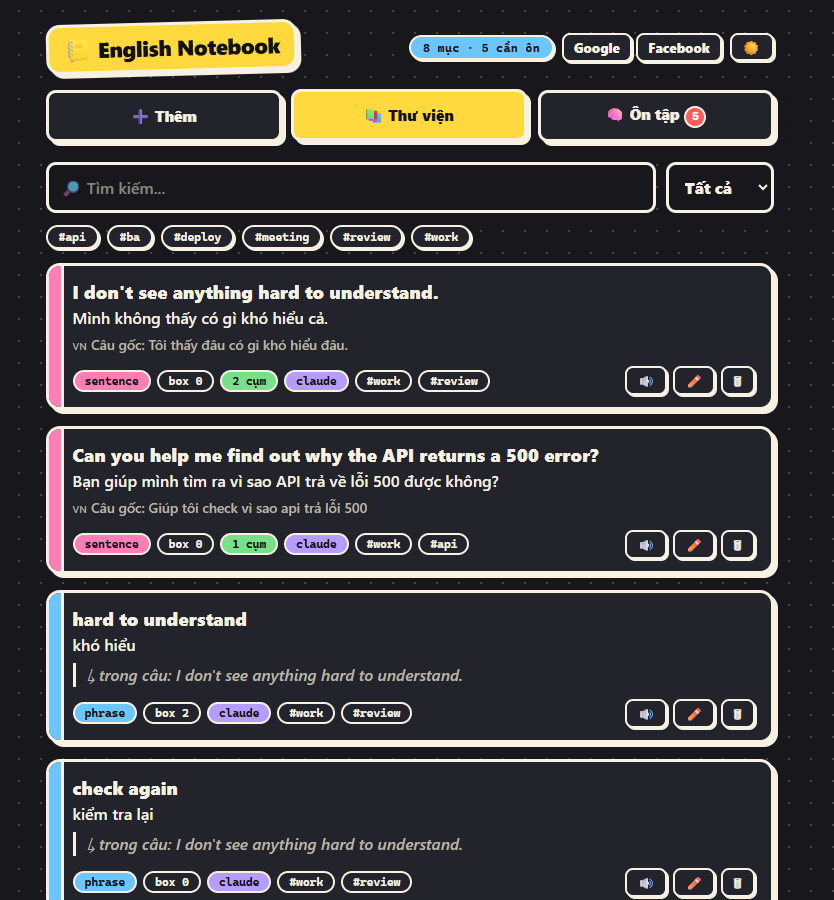
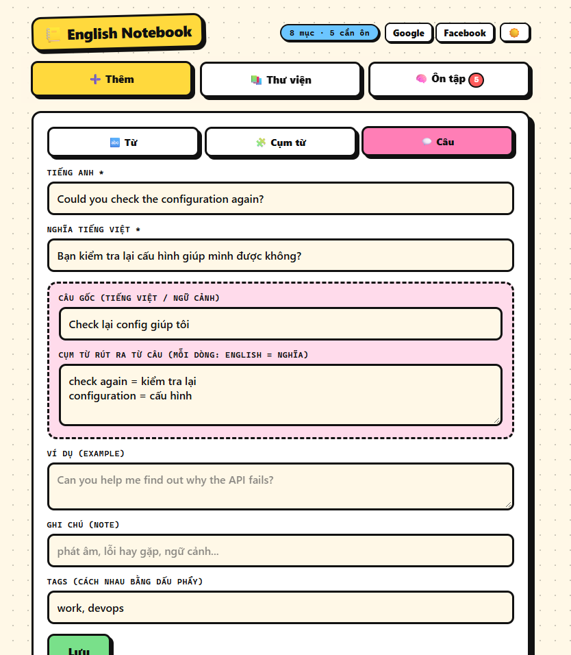
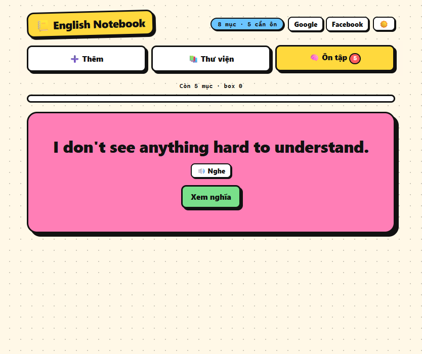
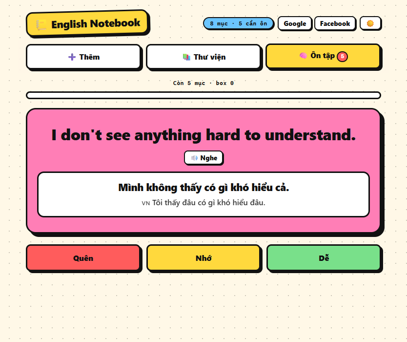
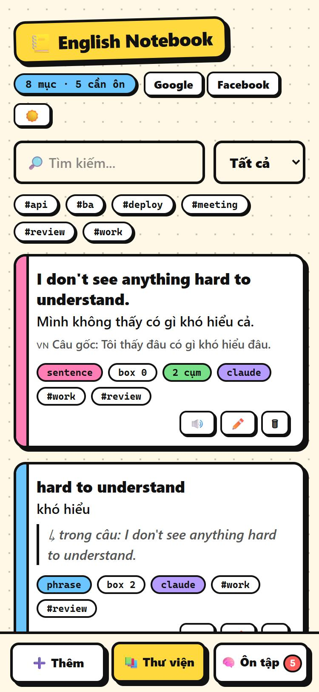

# 📒 English Notebook

Learn English from what you actually read and write at work.
Save words, phrases and sentences (with the Vietnamese meaning and the original context), then review them with spaced repetition.

**Live demo:** https://english-notebook.tiennhm.io.vn

An installable PWA in plain HTML, CSS and JavaScript. No build step, works offline, optional Google login with cloud sync, optional Claude Code integration.

<p align="center">
  
  
</p>

## Contents

- [Features](#features)
- [Screenshots](#screenshots)
- [Quick start](#quick-start)
- [How to use the app](#how-to-use-the-app)
- [Set up Google login and cloud sync](#set-up-google-login-and-cloud-sync)
- [Publish with GitHub Pages and a custom domain](#publish-with-github-pages-and-a-custom-domain)
- [Save from Claude Code (MCP)](#save-from-claude-code-mcp)
- [Data, privacy and security](#data-privacy-and-security)
- [Troubleshooting](#troubleshooting)
- [Project structure and development notes](#project-structure-and-development-notes)

## Features

- **Three kinds of cards**: word, phrase, sentence. Each has meaning, example, note and tags.
- **Context cards**: save a sentence with the original (Vietnamese) sentence, then list the expressions in it (`check again = kiểm tra lại`). Every expression becomes its own card that stays linked to the sentence.
- **Library**: search, filter by type or tag, text-to-speech, edit, delete.
- **Review**: Leitner boxes (1, 3, 7, 14 and 30 days). Rate each card with Quên / Nhớ / Dễ.
- **Daily goal, streak and rewards**: review N cards a day to keep your 🔥 streak. Earn XP and levels, 15 badges, 🧊 freezes that save your streak, and confetti when you reach the goal.
- **Share your achievements**: a share card image (streak, level, recalls, badges) plus ready-made posts for Facebook, X, LinkedIn and Telegram, or the phone's share sheet. The image is drawn on your device and has no name or email.
- **Lively motion**: bouncy page, card and reward animations (count-up numbers, flickering 🔥, floating "+XP", shaking card on Quên, confetti). It follows your system "reduce motion" setting, and you can force it on or off in the app.
- **Neo-brutalism UI** with a light, dark and system theme switch. Bottom tab bar on phones.
- **Offline first**: works without internet and can be installed from the browser.
- **Google login + Firestore sync** (optional). Without it, data stays in your browser.
- **Claude Code integration** (optional): an MCP server saves words and sentences for you.
- Export / import JSON.

## Screenshots

### Add a sentence with its expressions

<p align="center"></p>

### Review

<p align="center">
  
  
</p>

### On your phone

<p align="center"></p>

## Quick start

You need Python 3 (or any static file server). Nothing else.

```bash
git clone https://github.com/TienNHM/english-notebook.git
cd english-notebook
python -m http.server 5173 --directory .
```

Open http://localhost:5173. In Chrome or Edge, use "Install" in the address bar to add it as an app.

This is **local-only mode**: no login, and your data lives in your browser (`localStorage`). Use **Xuất JSON** in the Library tab to back it up.

The service worker (offline mode) needs `http://` or `https://`. Opening `index.html` directly still works, but without offline install.

Pick how far you want to go:

| Goal | What to do |
|---|---|
| Just try it | Quick start above |
| Same data on all devices | [Google login and cloud sync](#set-up-google-login-and-cloud-sync) |
| Use it from a phone, anywhere | [GitHub Pages](#publish-with-github-pages-and-a-custom-domain) (needs the cloud sync step too) |
| Let Claude save words for you | [Claude Code (MCP)](#save-from-claude-code-mcp) |

## How to use the app

### Add

1. Open **➕ Thêm** and choose a type: **Từ** (word), **Cụm từ** (phrase) or **Câu** (sentence).
2. Fill in the English text and the Vietnamese meaning. Example, note and tags are optional.
3. For a **sentence**, two extra fields appear:
   - **Câu gốc**: the original sentence, for example the Vietnamese you wanted to say.
   - **Cụm từ rút ra**: one expression per line as `english = nghĩa`. Each line becomes a separate phrase card linked to the sentence.
4. Press **Lưu**. Adding something that already exists asks for confirmation.

### Library

- Search matches English, meaning, example, note and the original sentence.
- Filter by type with the dropdown, or by tag by clicking a `#tag`.
- 🔊 reads the English text aloud (your browser's voice), ✏️ edits, 🗑 deletes. Deleting a sentence also deletes the expressions linked to it (it asks first).

### Review

- **🧠 Ôn tập** shows the cards that are due. The badge on the tab is how many.
- Think of the meaning, press **Xem nghĩa**, then rate yourself:

| Button | What happens |
|---|---|
| **Quên** | Back to box 0, comes again in 10 minutes (and again in this session) |
| **Nhớ** | Up 1 box |
| **Dễ** | Up 2 boxes |

Boxes 0 to 5 come back after 0, 1, 3, 7, 14 and 30 days.
Cards that came from a sentence show the sentence under the answer.

### Daily goal, streak and rewards

- The panel at the top of **🧠 Ôn tập** shows today's goal (default **10 cards**, change it in **🏆 Thưởng**: 5, 10, 15, 20 or 30), your 🔥 streak and the last 7 days.
- Only **Nhớ** and **Dễ** count toward the goal. **Quên** gives a little XP but does not count. If you have fewer cards than the goal, the goal is the number of cards you have.
- **Streak 🔥**: the number of days in a row you reached the goal. If you have not finished today yet, yesterday's streak is kept and the 🔥 pill turns red as a warning.
- **Freeze 🧊**: every time your streak reaches a multiple of 7 days you earn one (you can hold 2). If you miss exactly one day and have a freeze, it is used automatically and your streak continues. Missing more days than you have freezes breaks the streak.
- **Practice mode 💪**: if no cards are due but you have not reached the goal, press "Ôn thêm" to review cards that are not due yet (soonest first). So you can always keep your streak.
- **XP and levels**: Quên +1, Nhớ +3, Dễ +5, and +20 bonus when you reach the daily goal. Level = `floor(sqrt(XP / 30)) + 1`.
- **Badges**: 15 badges for streaks (3, 7, 14, 30, 100 days), number of recalls (50, 200, 1000), library size (10, 50, 100 cards), 10 sentences, and a card in box 5. A celebration with confetti appears when you reach the goal, level up or unlock a badge (it is skipped if your system asks for reduced motion).
- Days are counted in your **local time zone**.

### Share your achievements

Open **🏆 Thưởng → 📣 Chia sẻ thành tích**, or press **📣 Chia sẻ** in the celebration pop-up.

- The dialog shows a share card (1080×1080) and an editable text, for example `🔥 9-day streak · Level 5 · 108 cards recalled · 6/15 badges on English Notebook! ...`.
- **📲 Chia sẻ…** (phones and some browsers) opens the system share sheet with the image attached.
- **Facebook, X, LinkedIn, Telegram** open that site's share page with your text and the link to the app. These sites do not accept an image from a link (and LinkedIn takes only the link), so press **⬇ Tải ảnh** (or **🖼 Chép ảnh**) and attach the image yourself.
- **📋 Chép chữ** copies the text and the link. 
- **Privacy**: the card is drawn in your browser. It contains only numbers and badge icons: no name, no email. Nothing is uploaded when you open the dialog; data leaves your device only when you post it.
- **Link preview**: `index.html` has Open Graph and Twitter Card tags that use `og-image.png` (1200×630). Social sites cache previews, so after you change the image use the [Facebook Sharing Debugger](https://developers.facebook.com/tools/debug/) or the [LinkedIn Post Inspector](https://www.linkedin.com/post-inspector/) to refresh it. If you host the app on another domain, change the URLs in the `<meta>` tags and `SITE_URL` in `share.js`.

### Motion and animations

- The logo drops in and the tabs rise one by one; Library cards come in one after another, a card you just added flashes, and a deleted card slides away.
- In **Review**, each new card slides in, **Quên** shakes it, the answer pops open, and `+3 XP` floats up. In **🏆 Thưởng** the numbers count up, the badge shine sweeps over unlocked badges, and the 🔥 flickers. Changing the theme fades the colours.
- **Accessibility**: by default the app follows your operating system. If "reduce motion" (Windows: *Animation effects* off; macOS: *Reduce motion*) is on, all animations are off.
- To override it, open **🏆 Thưởng → Hiệu ứng chuyển động** and choose **Theo hệ thống** (default), **Luôn bật** or **Tắt**. The choice is saved in your browser. If your system has motion off, the app shows a one-time hint about this switch.

### Theme

The round button in the header cycles **System → Light → Dark**. Your choice is saved in the browser.

## Set up Google login and cloud sync

Without this the app is local-only. With it, you sign in with Google and every device shows the same items. Firestore keeps an offline cache, so adding and reviewing works without internet and syncs later.

The free **Spark** plan is enough for personal use (no credit card; free daily quota of about 50,000 reads and 20,000 writes). Check the current limits on the [Firebase pricing page](https://firebase.google.com/pricing).

1. **Create a project** at https://console.firebase.google.com (Google Analytics is not needed).
2. **Add a Web app**: Project overview → `</>` → register it (no Firebase Hosting needed). Copy the config.
3. **Put the config in `firebase-config.js`** (these web keys are public identifiers, not secrets):

   ```js
   export const firebaseConfig = {
     apiKey: "...",
     authDomain: "<project-id>.firebaseapp.com",
     projectId: "<project-id>",
     appId: "...",
   };
   ```
4. **Turn on Google sign-in**: Build → Authentication → Get started → Sign-in method → **Google** → Enable → choose a support email → Save.
5. **Create the database**: Build → Firestore Database → Create database → pick a region near you → **production mode**.
6. **Deploy the security rules** from `firestore.rules`. Each signed-in user can only read and write their own data (`users/{uid}/items/{id}` for cards and `users/{uid}/meta/{id}` for streak and rewards). Redeploy them whenever `firestore.rules` changes:

   ```bash
   npx firebase-tools login
   npx firebase-tools deploy --only firestore:rules --project <project-id>
   ```
   You can also paste the content of `firestore.rules` in Firestore → Rules → Publish.
7. **Authorized domains**: Authentication → Settings → Authorized domains. Add every domain you host the app on. `localhost` is already there.
8. Reload the app. The header now shows **Google** and **Facebook** buttons. Sign in with Google.

On your first login, items that were already in this browser are uploaded to your account.

### Facebook login (optional, not required)

The Facebook button needs extra setup, so skip it if you only need Google.

1. Create an app at https://developers.facebook.com. Copy **App ID** and **App Secret** (Settings → Basic).
2. Firebase → Authentication → Sign-in method → **Facebook** → Enable → paste them → copy the **OAuth redirect URI** that Firebase shows.
3. In the Facebook app: Facebook Login → Settings → **Valid OAuth Redirect URIs** → paste it → save.
4. While the Facebook app is in *Development* mode, only you and the testers you add can sign in.

## Publish with GitHub Pages and a custom domain

The workflow `.github/workflows/pages.yml` publishes only the app files on every push to `master`. README, rules and screenshots are not published.

1. Push the repo to GitHub. On the free plan, GitHub Pages needs a **public** repo.
2. **Settings → Pages → Build and deployment → Source: GitHub Actions**.
3. Push to `master` (or run the workflow from the Actions tab). The site appears at `https://<user>.github.io/<repo>/`.

### Custom domain (for example `english-notebook.example.com`)

1. In your DNS provider add one record:

   | Type | Name | Value |
   |---|---|---|
   | `CNAME` | `english-notebook` | `<user>.github.io` |

   The value is your GitHub **username**, not the repo name. If you use Cloudflare, start with **DNS only** (grey cloud).
2. **Settings → Pages → Custom domain**: type the domain and save. GitHub adds a `CNAME` file to the repo (run `git pull`).
3. Wait for the DNS check to pass (minutes, sometimes hours), then tick **Enforce HTTPS**.
4. **Add the domain to Firebase** → Authentication → Settings → Authorized domains. Without this, Google login on the live site fails with `auth/unauthorized-domain`.

## Save from Claude Code (MCP)

The MCP server [english-notebook-mcp](https://github.com/TienNHM/english-notebook-mcp) lets Claude Code save words and sentences while you work. It has three tools: `add_vocabulary`, `add_sentence` (with linked expressions) and `list_inbox` (to avoid duplicates).

Short version, using **Firestore mode** so the items show up on every device and on the hosted site:

1. Create a service account key (Firebase console → Project settings → Service accounts → Generate new private key). Save the JSON **outside any git repo and outside synced folders**. It has full admin access to the project: never commit it, never paste it in a chat.
2. Find your user id: Authentication → Users, or `npx firebase-tools auth:export users.json --project <project-id>` and read `localId`.
3. Register the server (one line, run once):

   ```bash
   claude mcp add --scope user --env ENGLISH_NOTEBOOK_SERVICE_ACCOUNT="C:\path\to\key.json" --env ENGLISH_NOTEBOOK_UID="<your uid>" english-notebook -- node C:\path\to\english-notebook-mcp\server.mjs
   ```
4. Restart Claude Code and check with `claude mcp list`.

Without the two environment variables the server uses **inbox mode**: it writes `inbox.json` next to this app and the app imports it when it opens. That works only on `localhost` from this folder, not on the hosted site.

To make Claude save automatically, add a rule to your `CLAUDE.md`, for example:

> When I ask for help in Vietnamese, after answering call `add_sentence` with the natural English version
> and 2-3 useful expressions (tag: work). Do not save things I did not ask about.

Full details and troubleshooting are in the [MCP README](https://github.com/TienNHM/english-notebook-mcp#readme).

## Data, privacy and security

| Mode | Where your data is |
|---|---|
| Local-only | In your browser (`localStorage`). Clearing site data deletes it. Use **Xuất JSON** to back up. |
| Signed in | In your Firestore: cards at `users/<uid>/items`, streak / XP / badges at `users/<uid>/meta/progress`. Other people cannot read them because of `firestore.rules`. |

Streak, XP and badges are stored with your cards (in the browser, or in Firestore when you are signed in), so they sync between devices. If two devices have different progress, they are merged and nothing is lost (the larger number wins for each day).

- The Firebase web config in `firebase-config.js` is **not a secret**. The security rules protect the data.
- The service account key (MCP Firestore mode) **is** a secret. Keep it out of git and out of synced or shared folders. If you think it leaked, delete it in the Firebase console (Service accounts → Manage → Keys) and create a new one.
- `inbox.json` is in `.gitignore` because it holds your personal vocabulary.
- **Xuất JSON / Nhập JSON** give you a plain backup you control. Import skips items that already exist (same id).

## Troubleshooting

| Problem | Likely cause and fix |
|---|---|
| Header shows only "Local" | `firebase-config.js` is still `null`, or the browser cached the old file. Hard refresh (Ctrl+F5). |
| `auth/unauthorized-domain` when signing in | Add the site's domain in Authentication → Settings → Authorized domains. |
| Popup closes or is blocked | Allow popups for the site and try again. |
| `Missing or insufficient permissions` / `permission-denied` | The rules are not deployed, or they do not match `users/{uid}/items/{id}`. Redeploy `firestore.rules`. |
| `Cloud Firestore API has not been used...` | Create the database in the console first (Build → Firestore Database → Create database). |
| Facebook login says the app is not available | The Facebook app is in Development mode. Add yourself as a tester or publish the app. |
| Items saved by Claude do not show on the live site | You are in inbox mode. Set up Firestore mode (see above). |
| `inbox.json` 404 in the console | Harmless: the app looks for it at start-up and it does not exist. |
| Site shows an old version after a deploy | Hard refresh. The service worker is "network first", so a normal reload usually already gets the new files. |
| GitHub Actions deploy does not start | Settings → Pages → Source must be **GitHub Actions**, and the workflow file must be on `master`. |
| `Enforce HTTPS` is greyed out | The DNS check has not passed yet. Wait, and check the `CNAME` record. |

## Project structure and development notes

| File | Purpose |
|---|---|
| `index.html`, `style.css` | Markup and neo-brutalism styles (light and dark tokens at the top of the CSS) |
| `app.js` | UI, library, review, rewards screen, theme, import / export, inbox import |
| `progress.js` | Streak, freeze, XP, level and badge logic (pure functions, no DOM) |
| `share.js` | Share text, social links and the share-card drawing (canvas) |
| `og-image.png` | Link preview image (1200×630) used by the Open Graph tags |
| `tests/` | Unit tests for `progress.js` and `share.js` |
| `cloud.js`, `firebase-config.js` | Firebase Auth and Firestore (loaded only when `firebase-config.js` is filled in) |
| `sw.js`, `manifest.webmanifest`, `icon.svg` | Offline cache and installable app |
| `firestore.rules`, `firebase.json` | Firestore security rules and CLI config |
| `.github/workflows/pages.yml` | Publishes the app files to GitHub Pages |
| `docs/screenshots/` | Images used in this README |

Things to remember when you change the code:

- **Adding a new app file?** Add it to the `FILES` list in `sw.js` (offline cache) **and** to the `cp` line in `.github/workflows/pages.yml`, otherwise it will not be published.
- **Tests**: the streak, freeze, XP, badge and share logic has unit tests. Run `node tests/progress.test.mjs` and `node tests/share.test.mjs` (Node 18+, no install).
- **Motion rules**: animate only `transform` and `opacity`, give animations `backwards` fill (so hover styles keep working), and keep every new animation under the motion switch at the end of `style.css` (it also covers `::before` and `::after`). In JavaScript, call `reduced()` before starting an animation. To test motion when your system has "reduce motion" on, set the app switch to **Luôn bật**.
- To redraw `og-image.png`, call `drawShareCard(canvas, {}, { wide: true, promo: true })` from `share.js` and save the canvas as a PNG.
- After changing the cached files, you can bump `CACHE` in `sw.js` to force clients to drop the old cache.
- Item shape (same in `localStorage` and Firestore): `id, type, text, meaning, example, note, original, sourceId, source, tags, box, due, created, reviews`.
- Progress shape: `{ days: { "YYYY-MM-DD": { n, xp, f (goal met), z (saved by a freeze) } }, badges: { id: unlockedAt }, fe (freezes earned), goal, updated }`. Streak, level and freezes left are calculated from it, so the merge of two devices is always safe.
- No build step and no dependencies in the app itself. The Firebase SDK is loaded from `gstatic.com` only when sync is configured.
