# English Notebook: system architecture

Diagrams are in `docs/diagrams/` (SVG shown here, PNG for slides, and the self-contained HTML source made with the diagram-design skill and the app palette). Version 2.0.

Contents: [1. Landscape](#1-system-landscape) · [2. Components](#2-components) · [3. Flows](#3-main-flows) · [4. Data model](#4-data-model) · [5. Deployment](#5-deployment-and-ci) · [6. Security](#6-security-and-trust-boundaries) · [7. Limits and decisions](#7-limits-and-design-decisions)

## 1. System landscape

Who talks to whom. Arrows show the direction of the request.

[PNG](diagrams/landscape.png) · [editable HTML](diagrams/landscape.html)

**Key idea of version 2:** the Firebase admin key lives only in the Worker. A user's machine holds only a personal token that can write to that user's own notebook, nothing else.

## 2. Components

| Component | Where | Tech | Role |
|---|---|---|---|
| **PWA** | repo `english-notebook`, GitHub Pages | Plain JS modules, service worker, Firebase Web SDK (loaded from gstatic) | UI: cards, Leitner review, streak/XP/badges, 4 styles, vault sharing, token screen. Works offline. |
| **Worker (agent API)** | `english-notebook/worker`, Cloudflare | Workers runtime, WebCrypto, KV | Verifies Firebase login, manages personal tokens, saves/lists items for agents with limits. |
| **MCP server** | repo `english-notebook-mcp`, runs on the learner's PC | Node 18+, `@modelcontextprotocol/sdk` | Gives agents three tools. Token mode (calls Worker), key mode (Firestore Admin SDK) or inbox mode (file). |
| **Skill / rules** | `skills/`, `rules/` in the MCP repo | Markdown | Tells the agent to coach English and when to call the tools. One source, copies for Cursor and `AGENTS.md`. |
| **Plugin + marketplace** | `.claude-plugin/` in the MCP repo | Claude Code plugin format | One-step install of MCP server + skill; asks for the token. |
| **Firebase Auth** | Google | Google sign-in | Identity (uid). |
| **Firestore** | Google | Rules per uid | Notebook data, progress, shared vaults. |

Module map of the PWA:

[PNG](diagrams/modules.png) · [editable HTML](diagrams/modules.html)

## 3. Main flows

### 3.1 Sign in and sync

[PNG](diagrams/flow-signin.png) · [editable HTML](diagrams/flow-signin.html)

### 3.2 Create a personal agent token

[PNG](diagrams/flow-token.png) · [editable HTML](diagrams/flow-token.html)

### 3.3 The agent saves a sentence

[PNG](diagrams/flow-agent-save.png) · [editable HTML](diagrams/flow-agent-save.html)

### 3.4 Share a vocabulary vault to another account

[PNG](diagrams/flow-vault-share.png) · [editable HTML](diagrams/flow-vault-share.html)

## 4. Data model

[PNG](diagrams/data-model.png) · [editable HTML](diagrams/data-model.html)

Worker storage (Cloudflare KV, not Firestore):

| Key | Value | Notes |
|---|---|---|
| `tok:<sha256>` | `{uid, label, created, lastUsed}` | Only the hash of the token is stored. |
| `user:<uid>` | list of hashes | Max 5 tokens per user. |
| `rate:<uid>:<yyyy-mm-dd>` | count | New items today; expires after 2 days. |

## 5. Deployment and CI

[PNG](diagrams/deployment.png) · [editable HTML](diagrams/deployment.html)

- **App:** every push to `master` publishes the app. New app files must be added to the `cp` line in `.github/workflows/pages.yml` **and** to `FILES` in `sw.js` (and bump the cache name in `sw.js`).
- **Worker:** deployed by hand with Wrangler (see [OPERATIONS.md](OPERATIONS.md)). Not part of Pages.
- **Plugin:** users install from the GitHub repo; a new version = bump `version` in `.claude-plugin/plugin.json`, tag, push.

## 6. Security and trust boundaries

[PNG](diagrams/trust-boundaries.png) · [editable HTML](diagrams/trust-boundaries.html)

| Secret / credential | Where it lives | Who can use it | If leaked |
|---|---|---|---|
| Firebase **service account key** | Worker secret `SERVICE_ACCOUNT` (and a local file on the owner's PC, git-ignored) | The Worker only | Create a new key in Firebase, `wrangler secret put` again, delete the old key. |
| **Personal token** `enb_…` | Learner's agent config (plugin stores it as sensitive) | Saves/lists in that one learner's notebook | Revoke in the app, create a new one. |
| **Firebase web config** (`firebase-config.js`) | Public in the repo | Anyone | Not a secret; access is controlled by Firestore rules and Auth. |

Main protections:

- Firestore rules: a user reads and writes only `users/<own uid>/…`; shared vaults are readable only when signed in and writable only by the owner.
- Worker: Firebase ID token fully verified (signature, issuer, audience, expiry); agent tokens are random 256-bit values, stored hashed; one token type cannot be used as the other; input size limits; 200 new items per user per day; CORS only for the app origin; no internal error details in responses.
- A leaked agent token can add cards to one notebook (within the daily limit) and read that notebook's item texts. It cannot read progress, change shares, or touch other users.
- Tests: `tests/` (app), `worker/tests/` (Worker, 20 tests), MCP repo `tests/` (client, token mode end to end, skill/tool consistency). `tests/rules.test.mjs` is run by hand against the real project.

## 7. Limits and design decisions

| Topic | Decision | Why / consequence |
|---|---|---|
| Backend | Firebase Auth + Firestore, no custom server for the app | Free tier is enough; offline cache built in. |
| Agent access | Cloudflare Worker with personal tokens | Admin key never leaves the owner; users paste one token. Works on the free plan (100k requests/day). |
| Token store | Workers KV | Simple and cheap. **Eventually consistent:** revoking can take seconds to about a minute; daily limit is soft. Durable Objects or D1 would fix both. |
| Cost owner | Owner of the Firebase project | Firestore free quota is shared by all users; per-user daily limit protects it. |
| Modes of the MCP server | token (default), key, inbox | Key and inbox modes remain for self-hosters and offline use. |
| Hosting | GitHub Pages + custom domain | Static files, no build step. |
| Sync conflicts | Last write wins per card | Fine for a personal notebook. |

[PNG](diagrams/mcp-mode.png) · [editable HTML](diagrams/mcp-mode.html)
